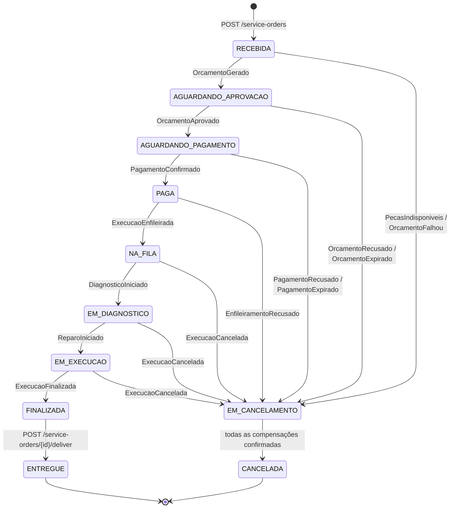
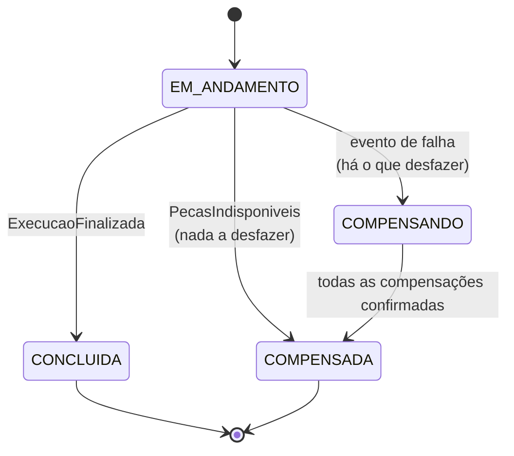
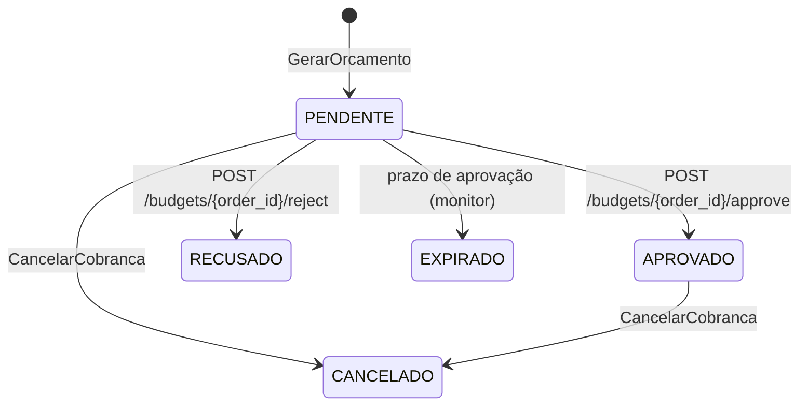
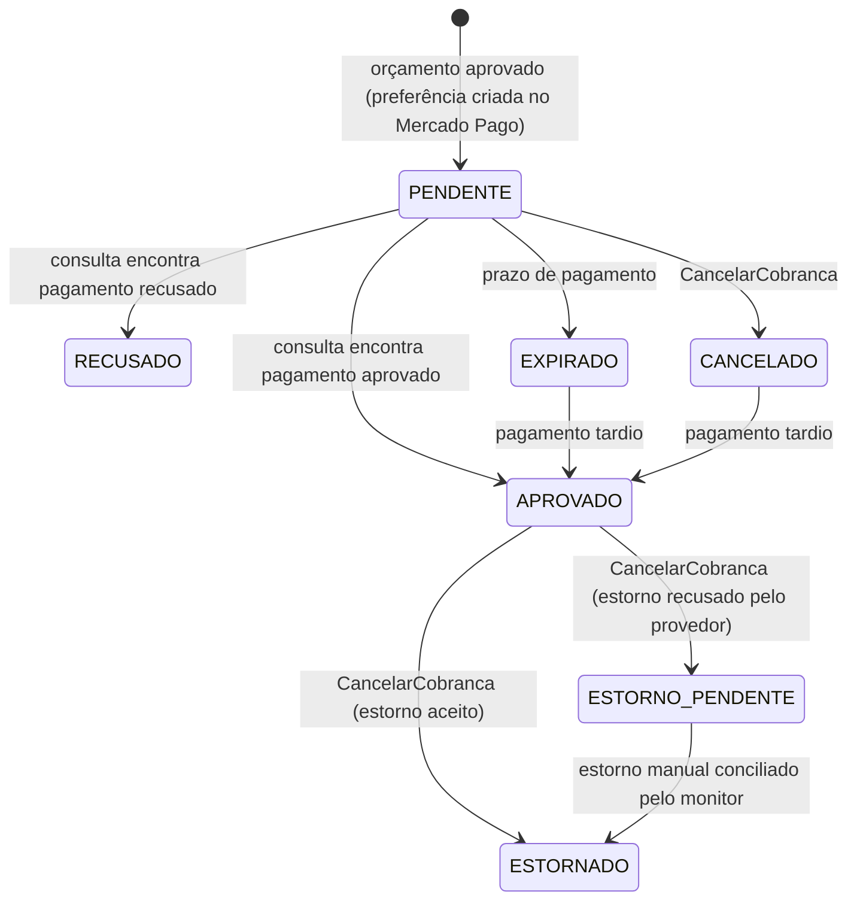
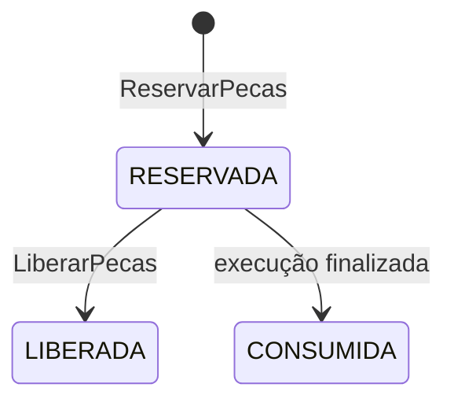
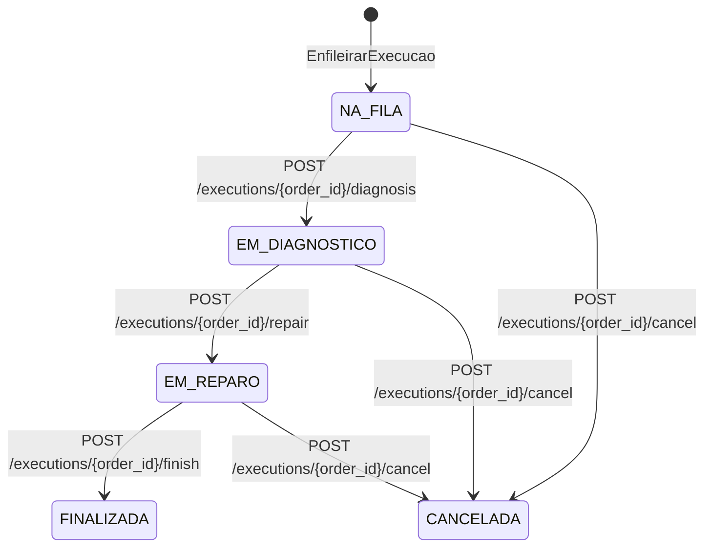

# Máquinas de estado

> Seis máquinas de estado, uma por entidade com ciclo de vida. Cada uma pertence a um
> serviço só e **só esse serviço muda o estado**. Os outros recebem a mudança por evento.

## 1. Ordem de serviço (OS Service)

Definida em [`app/domain/value_objects/service_order_status.py`](../../app/domain/value_objects/service_order_status.py).

| Status | Significado | Quem provoca |
|---|---|---|
| `RECEBIDA` | OS aberta; Saga reservando peças e gerando orçamento | Atendente (REST) |
| `AGUARDANDO_APROVACAO` | Orçamento enviado ao cliente | Evento do Billing |
| `AGUARDANDO_PAGAMENTO` | Orçamento aprovado; link de pagamento gerado | Evento do Billing |
| `PAGA` | Pagamento confirmado; enviando para a fila | Evento do Billing |
| `NA_FILA` | Aguardando mecânico | Evento do Execution |
| `EM_DIAGNOSTICO` | Mecânico diagnosticando | Evento do Execution |
| `EM_EXECUCAO` | Reparo em andamento | Evento do Execution |
| `FINALIZADA` | Reparo concluído; veículo pronto | Evento do Execution |
| `ENTREGUE` | Veículo retirado pelo cliente | Atendente (REST) |
| `EM_CANCELAMENTO` | Saga compensando | Orquestrador |
| `CANCELADA` | Compensações concluídas; motivo em `cancel_reason` | Orquestrador |

Quando não há nada a compensar (`PecasIndisponiveis`), a OS passa por `EM_CANCELAMENTO` e
chega a `CANCELADA` na mesma transação; o histórico registra as duas mudanças.

**Motivos de cancelamento** (`cancel_reason`): `PECAS_INDISPONIVEIS`, `ORCAMENTO_FALHOU`,
`ORCAMENTO_RECUSADO`, `APROVACAO_EXPIRADA`, `PAGAMENTO_RECUSADO`, `PAGAMENTO_EXPIRADO`,
`EXECUCAO_RECUSADA`, `EXECUCAO_CANCELADA`. A entidade recusa `EM_CANCELAMENTO` sem um desses
motivos.

**`EM_CANCELAMENTO` é um bloqueio semântico** (contramedida para a falta do "I" do ACID numa
Saga). Desse estado a OS só sai para `CANCELADA`: a entrega exige `FINALIZADA`, e o
orquestrador ignora qualquer evento de avanço de uma Saga que está compensando. Assim,
ninguém age sobre uma OS que está no meio de um rollback.

**Mudança em relação à Fase 3:** o `PATCH /service-orders/{id}/status` genérico **deixou de
existir**. O status muda por evento da Saga ou da execução, e só a entrega continua manual.
Um PATCH livre permitiria pular etapas da Saga e deixar os 3 serviços inconsistentes.

## 2. Saga (OS Service, tabelas `saga_instances` e `saga_steps`)

Definida em [`app/domain/entities/saga.py`](../../app/domain/entities/saga.py).

Cada etapa tem um registro em `saga_steps` com `status` `PENDENTE`, `CONCLUIDA` ou `FALHOU`,
o número de envios do comando (`attempts`) e o horário do último envio (`last_sent_at`). As
compensações (`LIBERAR_PECAS`, `CANCELAR_COBRANCA`) são etapas como as outras.

As compensações sempre têm sucesso de negócio. Se uma delas falhar por problema técnico, a
mensagem passa pelas novas tentativas e vai para a DLQ, o que dispara o alerta no New Relic.
A Saga fica em `COMPENSANDO`, e o orquestrador reenvia o comando a cada 120 s enquanto a
confirmação não chega (ver [mensageria.md](mensageria.md)).

Um `PagamentoConfirmado` que chega com a Saga em `COMPENSANDO` ou `COMPENSADA` não reabre
nada: o orquestrador só envia `CancelarCobranca` de novo, para estornar o pagamento tardio.

## 3. Orçamento (Billing Service)

O prazo de aprovação é `APPROVAL_TIMEOUT_MINUTES` (padrão 1440, 24 h). Aprovar ou recusar
depois do prazo responde `422`, mesmo que o monitor ainda não tenha marcado o orçamento
como `EXPIRADO`.

## 4. Pagamento (Billing Service)

- O prazo de pagamento é `PAYMENT_TIMEOUT_MINUTES` (padrão 60). Ao expirar, recusar ou
  cancelar, o Billing também expira o link no Mercado Pago (melhor esforço).
- Pagamentos `EXPIRADO` ou `CANCELADO` continuam sendo consultados por
  `LATE_PAYMENT_WINDOW_HOURS` (padrão 24). Se o cliente pagou no último instante, o pagamento
  vira `APROVADO`, o Billing publica `PagamentoConfirmado` e a Saga pede o estorno.
- `ESTORNO_PENDENTE` existe porque o provedor pode recusar o estorno de forma definitiva (o
  sandbox do Mercado Pago recusa estorno por API). A recusa não trava a Saga: a compensação é
  confirmada, o log registra `ESTORNO MANUAL NECESSÁRIO` e o estorno é feito pelo painel do
  Mercado Pago. Quando a consulta passa a mostrar o pagamento estornado, o monitor muda o
  status para `ESTORNADO` (`refund_id = manual`).

## 5. Reserva de peças (Execution Service)

Uma reserva por OS. Ao finalizar a execução, as peças reservadas são baixadas do estoque
(`stock_quantity` e `reserved_quantity` diminuem juntos).

## 6. Execução (Execution Service)

Cada mudança grava uma entrada na `timeline` e publica um evento para o orquestrador. O
cancelamento exige o motivo (`reason`), que vai no evento `ExecucaoCancelada`.

**Regra de capacidade da fila:** o Execution aceita no máximo `EXECUTION_QUEUE_CAPACITY`
execuções em `NA_FILA` (padrão 20). Acima disso, responde `EnfileiramentoRecusado`. É uma
regra de negócio real (a oficina não aceita mais carros do que comporta) e também o jeito
controlado de **provocar uma falha tardia**: com a capacidade em 0, a Saga precisa desfazer
uma cobrança já paga.
