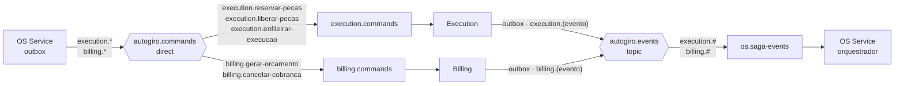

# Mensageria

> Comunicação assíncrona entre os serviços. Broker: **RabbitMQ**
> ([ADR-007](../adr/ADR-007-rest-na-borda-rabbitmq-entre-servicos.md)). Confiabilidade:
> [ADR-009](../adr/ADR-009-confiabilidade-das-mensagens.md).

## Envelope

Todo comando e todo evento usam o mesmo envelope JSON no corpo da mensagem
([`app/application/messages.py`](../../app/application/messages.py), igual nos três serviços):

```json
{
  "type": "ReservarPecas",
  "kind": "command",
  "saga_id": "0b6e4f0e-3c1a-4a6e-8d47-2f5b9c7e1a20",
  "order_id": 42,
  "payload": { "items": [{ "part_id": 3, "quantity": 2 }] },
  "message_id": "6f1c0e0a-6b0f-4e0b-9a51-0d7c2f1a9b11",
  "version": 1,
  "causation_id": null,
  "occurred_at": "2026-11-10T13:00:00+00:00",
  "producer": "os-service"
}
```

| Campo | Uso |
|---|---|
| `message_id` | UUID único da mensagem. Chave de deduplicação (`processed_messages`) |
| `type` | Nome da mensagem (catálogo abaixo). O consumidor escolhe o handler por ele |
| `kind` | `command` (pede uma ação) ou `event` (informa um fato) |
| `version` | Versão do contrato (hoje `1`). Mudança só aditiva mantém a versão; consumidor que recebe versão maior que a que conhece manda para a DLQ |
| `saga_id` | Liga todas as mensagens de uma mesma Saga; vai também como atributo dos spans e nos logs |
| `order_id` | Id da OS. Chave da idempotência de negócio nos participantes |
| `causation_id` | `message_id` da mensagem que causou esta (o comando que gerou o evento). Nulo em mensagens que nascem de uma requisição REST, do monitor de pagamentos ou de um reenvio |
| `occurred_at` | Instante UTC (ISO 8601) em que a mensagem foi criada |
| `producer` | `os-service`, `billing-service` ou `execution-service` |

**Propriedades AMQP:** `message_id` e `type` repetidos; `content_type: application/json`;
`delivery_mode: 2` (persistente). Cabeçalhos: `traceparent` (e `tracestate`, quando houver)
com o contexto W3C do trace em que a mensagem foi criada
([ADR-011](../adr/ADR-011-rastreamento-opentelemetry-new-relic.md)). Nas filas de retry e DLQ
a mensagem ganha também `x-retry-count` e `x-error`.

## Topologia no RabbitMQ



| Recurso | Tipo | Observação |
|---|---|---|
| `autogiro.commands` | exchange `direct`, durável | Um routing key por comando: `<serviço>.<comando-em-kebab-case>` |
| `autogiro.events` | exchange `topic`, durável | Routing key `<produtor>.<evento-em-kebab-case>`. Um consumidor novo pode assinar eventos sem mudar quem publica |
| `execution.commands`, `billing.commands`, `os.saga-events` | filas duráveis | Cada uma com uma fila `.retry` e uma `.dlq` associadas |
| `<fila>.retry` | fila durável com `x-message-ttl: 5000` | Ao expirar, devolve a mensagem para a fila de origem (dead-letter para o exchange padrão, com o nome da fila como routing key) |
| `<fila>.dlq` | fila durável | Destino final. Mensagens aqui disparam alerta no New Relic |

Cada serviço declara os dois exchanges e as próprias filas ao subir; a Terraform do
`autogiro-infra-k8s` sobe só o broker. Configurações do consumidor: `prefetch_count = 10`,
ack manual **depois** do commit da transação local (ou depois de a mensagem estar a salvo
na fila de retry ou na DLQ). Publicação com *publisher confirms*.

No cluster, o RabbitMQ (imagem `rabbitmq:4.0-management`) roda com uma réplica e **sem volume
persistente**: o que estava na fila se perde se o pod for recriado. O desenho tolera isso em
parte (ver [saga.md](saga.md), "Falhas de infraestrutura").

## Publicação pelo outbox

Os três serviços gravam a mensagem no próprio outbox, na mesma transação do efeito, junto
com o contexto do trace (`trace_context`). Um laço em segundo plano publica as pendentes a
cada `OUTBOX_POLL_SECONDS` (1 s), até 100 por ciclo, na ordem em que foram gravadas, e marca
cada uma como publicada depois do *publisher confirm*.

- No OS e no Billing (PostgreSQL), o publicador lê as pendentes com
  `SELECT … FOR UPDATE SKIP LOCKED`: cada réplica publica só o que nenhuma outra pegou. No
  OS, cada mensagem tem a própria transação (trava, publica, marca, commit), para o commit de
  uma não soltar a trava das seguintes.
- No Execution (MongoDB), o publicador não reserva as mensagens: com duas réplicas, um evento
  pode ser publicado duas vezes. O consumidor descarta a repetição pelo `message_id`.
- Se o processo cair entre o publish e a marcação, a mensagem sai de novo, com o mesmo
  `message_id`, e também é descartada no consumo.

## Retry e DLQ

```
falha técnica ao processar
   ├── x-retry-count < 3 → publica em <fila>.retry (x-retry-count + 1) → volta à fila em 5 s
   └── x-retry-count = 3 → publica em <fila>.dlq (com x-error) → ack da original
envelope inválido (JSON quebrado, campo faltando, versão desconhecida)
   └── direto para <fila>.dlq, sem novas tentativas
```

- **Só falhas técnicas** (exceção, banco fora, provedor fora) entram em retry. São 3 novas
  tentativas depois da primeira (`MESSAGE_MAX_RETRIES`), a cada 5 s
  (`MESSAGE_RETRY_DELAY_MS`).
- **Falha de negócio não é exceção:** peça indisponível, orçamento recusado e fila cheia são
  **eventos** normais, que o orquestrador trata.
- A DLQ é reprocessada manualmente pelo painel do RabbitMQ (*Move messages*) depois de
  corrigida a causa.

## Catálogo de mensagens

São **23 mensagens**: 5 comandos, 9 eventos do Execution e 9 do Billing.

### Comandos (OS Service → participantes)

| Comando | Para | Routing key | `payload` |
|---|---|---|---|
| `ReservarPecas` | Execution | `execution.reservar-pecas` | `items: [{part_id, quantity}]` |
| `LiberarPecas` ⟲ | Execution | `execution.liberar-pecas` | `reason` |
| `EnfileirarExecucao` | Execution | `execution.enfileirar-execucao` | `vehicle: {plate, brand, model}`, `services: [{service_type_id, name, quantity}]`, `parts: [{part_id, name, quantity}]`, `notes` |
| `GerarOrcamento` | Billing | `billing.gerar-orcamento` | `client: {id, name, email}`, `services: [{service_type_id, name, quantity, unit_price}]`, `parts: [{part_id, name, quantity, unit_price}]` |
| `CancelarCobranca` ⟲ | Billing | `billing.cancelar-cobranca` | `reason` |

⟲ = comando de compensação. O `reason` é o motivo de cancelamento da OS
(`PAGAMENTO_RECUSADO`, `EXECUCAO_RECUSADA`…), ou `PAGAMENTO_TARDIO` no estorno de um
pagamento que chegou depois do fim da Saga.

### Eventos do Execution Service

| Evento | Routing key | `payload` | Quando |
|---|---|---|---|
| `PecasReservadas` | `execution.pecas-reservadas` | `items: [{part_id, name, quantity, unit_price}]` | Todas as peças reservadas (lista vazia se a OS não pediu peças) |
| `PecasIndisponiveis` | `execution.pecas-indisponiveis` | `missing: [{part_id, requested, available, reason: SEM_ESTOQUE│NAO_ENCONTRADA}]` | Alguma peça falta; nada foi reservado |
| `PecasLiberadas` | `execution.pecas-liberadas` | `released: bool` | Compensação confirmada (`released: false` se não havia o que liberar) |
| `ExecucaoEnfileirada` | `execution.execucao-enfileirada` | `position` | OS entrou na fila |
| `EnfileiramentoRecusado` | `execution.enfileiramento-recusado` | `reason: FILA_CHEIA` | Capacidade atingida |
| `DiagnosticoIniciado` | `execution.diagnostico-iniciado` | `note` | Mecânico iniciou o diagnóstico |
| `ReparoIniciado` | `execution.reparo-iniciado` | `note` | Mecânico iniciou o reparo |
| `ExecucaoFinalizada` | `execution.execucao-finalizada` | `note` | Reparo concluído; reserva consumida |
| `ExecucaoCancelada` | `execution.execucao-cancelada` | `reason` | Mecânico cancelou (por exemplo, reparo inviável) |

### Eventos do Billing Service

| Evento | Routing key | `payload` | Quando |
|---|---|---|---|
| `OrcamentoGerado` | `billing.orcamento-gerado` | `budget_id`, `total` | Orçamento criado e enviado ao cliente |
| `OrcamentoFalhou` | `billing.orcamento-falhou` | `reason` | Orçamento inválido: sem linhas, preço ausente ou total zero |
| `OrcamentoAprovado` | `billing.orcamento-aprovado` | `budget_id`, `payment_id`, `payment_link`, `amount` | Cliente aprovou; preferência criada no Mercado Pago |
| `OrcamentoRecusado` | `billing.orcamento-recusado` | `budget_id` | Cliente recusou |
| `OrcamentoExpirado` | `billing.orcamento-expirado` | `budget_id` | Sem resposta dentro de `APPROVAL_TIMEOUT_MINUTES` |
| `PagamentoConfirmado` | `billing.pagamento-confirmado` | `payment_id`, `mp_payment_id`, `amount` | Consulta encontrou pagamento aprovado (inclusive tardio) |
| `PagamentoRecusado` | `billing.pagamento-recusado` | `payment_id`, `mp_payment_id`, `status_detail` | Consulta encontrou pagamento recusado |
| `PagamentoExpirado` | `billing.pagamento-expirado` | `payment_id` | Sem pagamento dentro de `PAYMENT_TIMEOUT_MINUTES` |
| `CobrancaCancelada` | `billing.cobranca-cancelada` | `estornado: bool`, `refund_id`, `estorno_pendente: bool` | Compensação confirmada |

## Garantias, em resumo

| Garantia | Como |
|---|---|
| Mensagem não se perde entre o banco e o broker | Outbox transacional nos três serviços |
| Mensagem não se perde no broker | Filas e exchanges duráveis, mensagens persistentes, *publisher confirms*. Como o broker no cluster não tem volume, a perda num reinício é coberta pelo reenvio de etapa parada (só para etapas com comando) |
| Efeito não se repete | `processed_messages` + idempotência de negócio por `order_id` |
| Mensagem problemática não trava a fila | 3 novas tentativas → DLQ → alerta |
| Ordem | Não é garantida entre filas. O orquestrador decide pela etapa atual da Saga, não pela ordem de chegada |
