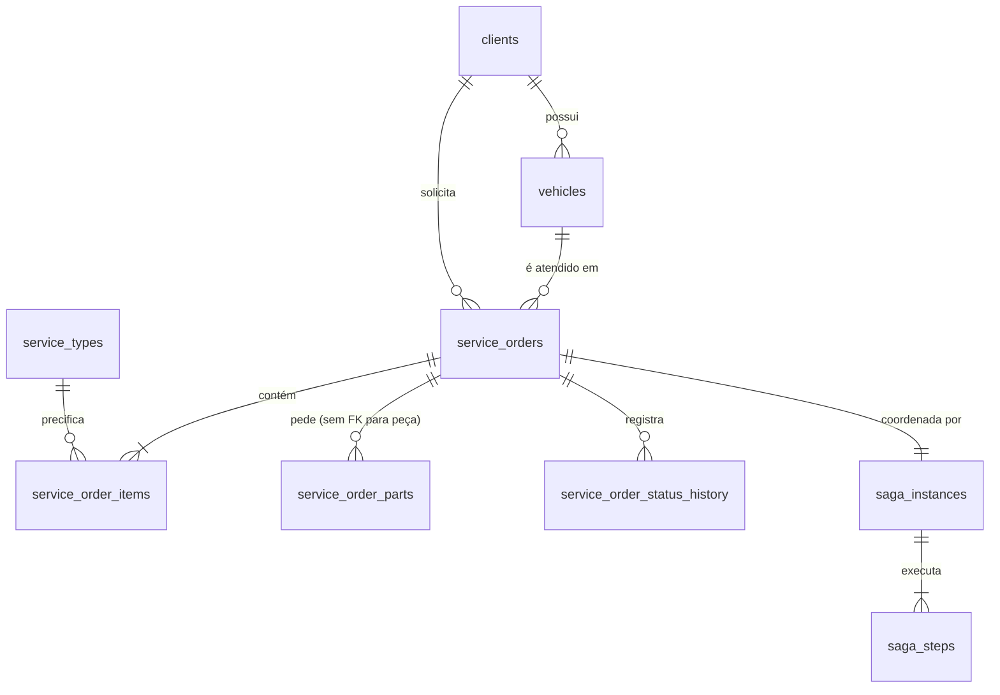

# Posse dos dados

> Cada serviço tem banco próprio, e nenhum serviço acessa o banco de outro.
> **Regra:** cada dado tem **um único dono**, que é o único que escreve nele. Outros
> serviços recebem **cópias** por mensagem, nunca por leitura no banco do dono.

## Do banco único da Fase 3 para três bancos

| Tabela da Fase 3 | Dono agora | Destino |
|---|---|---|
| `clients` | **OS Service** | Igual à Fase 3 |
| `vehicles` | **OS Service** | Igual à Fase 3 |
| `service_types` | **OS Service** | Catálogo de serviços com preço |
| `service_orders` | **OS Service** | Deixa de calcular o orçamento: `budget_total` e `payment_link` são cópias vindas do Billing |
| `service_order_items` | **OS Service** | Serviço, quantidade e preço unitário no momento da abertura |
| `service_order_parts` | **OS Service** (pedido) | Guarda **o que foi pedido** (`part_id`, quantidade) e, depois da reserva, a **cópia** de nome e preço vinda do Execution. **Sem FK** para peças |
| `parts` | **Execution Service** | Vira a coleção `parts` no MongoDB |
| `users` | — | **Não foi trazida.** Legado sem uso desde a autenticação por CPF |
| — | **OS Service** | Novas: `service_order_status_history`, `saga_instances`, `saga_steps`, `outbox`, `processed_messages` e a view `auth.clients` |
| — | **Billing Service** | Novas: `budgets`, `budget_lines`, `payments`, `outbox`, `processed_messages` |
| — | **Execution Service** | Novas coleções: `reservations`, `executions`, `outbox`, `processed_messages`, `counters` |

## Modelo de cada banco

### OS Service — PostgreSQL (Neon, projeto `autogiro-os`, banco `autogiro_os`)

Schema em [`migrations/`](../../migrations/), aplicado por
`python -m app.infrastructure.migrations` (cada arquivo uma única vez, em ordem, registrado em
`schema_migrations`).

| Tabela | Campos que importam para a Saga |
|---|---|
| `service_orders` | `status`, `cancel_reason`, `budget_total` (cópia), `payment_link` (cópia) |
| `service_order_parts` | `part_id` (id no Execution), `quantity`, `part_name` e `unit_price` (cópias, preenchidas após `PecasReservadas`) |
| `service_order_status_history` | `from_status`, `to_status`, `reason`, `source` (`api` ou o tipo do evento), `occurred_at` |
| `saga_instances` | `id` (= `saga_id`), `order_id` (**único**: uma Saga por OS), `state`, `current_step`, `failure_reason`, `started_at`, `updated_at`, `finished_at` |
| `saga_steps` | `saga_id`, `step`, `status` (`PENDENTE`, `CONCLUIDA`, `FALHOU`), `attempts`, `last_sent_at`, `finished_at` |
| `outbox` | `message_id`, `message_type`, `exchange`, `routing_key`, `body`, `trace_context`, `created_at`, `published_at` |
| `processed_messages` | `message_id` (PK), `processed_at` |

A OS não guarda o `saga_id`: a ligação é `saga_instances.order_id`.

### Billing Service — PostgreSQL (Neon, projeto `autogiro-billing`, banco `autogiro_billing`)

| Tabela | Campos |
|---|---|
| `budgets` | `id`, `order_id` (**único**), `saga_id`, `client_id`, `client_name` e `client_email` (cópias), `total`, `status`, `created_at`, `expires_at`, `decided_at` |
| `budget_lines` | `budget_id`, `kind` (`SERVICO` ou `PECA`), `reference_id`, `description`, `quantity`, `unit_price` |
| `payments` | `id`, `budget_id`, `order_id`, `saga_id`, `amount`, `status`, `external_reference` (**único**), `mp_preference_id`, `payment_link`, `mp_payment_id`, `status_detail`, `refund_id`, `expires_at`, timestamps |
| `outbox` | Mesma forma do outbox do OS Service, com `trace_context` |
| `processed_messages` | `message_id` (PK), `processed_at` |

Postgres porque é dinheiro: aprovar o orçamento e criar o pagamento acontecem numa
transação ACID local.

### Execution Service — MongoDB (Atlas M0)

| Coleção | Documento |
|---|---|
| `parts` | `{_id: int, name, description, unit, unit_price, stock_quantity, reserved_quantity, created_at, updated_at}` |
| `counters` | Sequência usada para gerar o `_id` numérico das peças |
| `reservations` | `{order_id (único), saga_id, status: RESERVADA│LIBERADA│CONSUMIDA, items: [{part_id, name, quantity, unit_price}], created_at, updated_at}` |
| `executions` | `{order_id (único), saga_id, vehicle: {plate, brand, model}, services, parts, notes, status, cancel_reason, queued_at, timeline: [{status, at, note}]}` |
| `outbox` | `{_id: message_id, type, exchange, routing_key, body, trace_context, created_at, published_at}` |
| `processed_messages` | `{_id: message_id, processed_at}` |

MongoDB porque a execução é um documento que cresce: a linha do tempo de diagnóstico e
reparo tem tamanho e conteúdo variáveis. A reserva de várias peças, o evento de resposta e o
registro da mensagem processada vão numa **transação multi-documento** (o Atlas M0 é um
replica set; localmente o Mongo sobe com `--replSet rs0`).

## Cópias de dados e como chegam

| Dado copiado | Dono | Quem guarda a cópia | Chega por |
|---|---|---|---|
| Nome e preço da peça reservada | Execution | OS (`service_order_parts`) | Evento `PecasReservadas` |
| Nome e preço da peça, para o orçamento | Execution (via OS) | Billing (`budget_lines`) | Comando `GerarOrcamento`, montado com a cópia que o OS acabou de receber |
| Serviços, quantidades e preços da OS | OS | Billing (`budget_lines`) | Comando `GerarOrcamento` |
| Nome e e-mail do cliente | OS | Billing (`client_name`, `client_email`) | Comando `GerarOrcamento` (o Billing avisa o cliente do orçamento) |
| Total do orçamento | Billing | OS (`budget_total`) | Evento `OrcamentoGerado` |
| Link de pagamento | Billing | OS (`payment_link`) | Evento `OrcamentoAprovado` |
| Veículo, serviços, peças e observações | OS | Execution (`executions`) | Comando `EnfileirarExecucao` |
| Status da execução | Execution | OS (`status` + histórico) | Eventos `DiagnosticoIniciado`, `ReparoIniciado`, `ExecucaoFinalizada`, `ExecucaoCancelada` |

As cópias são **instantâneas do momento da mensagem**. Se o preço de uma peça mudar depois da
reserva, o orçamento não muda, e isso é o comportamento correto para uma cobrança.

## Exceção documentada: a Lambda de autenticação

A Lambda `autogiro-auth` precisa localizar o cliente pelo CPF, e `clients` pertence ao OS
Service. A decisão está no [ADR-013](../adr/ADR-013-lambda-no-contexto-de-atendimento.md):

- a Lambda é tratada como **componente de autenticação do contexto de Atendimento**, o
  mesmo dono de `clients`. Não é um dos 3 microsserviços;
- ela usa um **usuário Postgres próprio** (`auth_reader`), a quem a migration
  `002_contrato_autenticacao.sql` concede apenas `USAGE` no schema `auth` e `SELECT` na view
  `auth.clients (id, name, cpf_cnpj, is_active)`, publicada pelo OS Service como contrato;
- o `search_path=auth` vai na própria URL de conexão da Lambda (saída `auth_database_url` do
  [`terraform/`](../../terraform/outputs.tf)). Assim a consulta atual da Lambda
  (`FROM clients`) lê a view **sem mudar uma linha de código** do `autogiro-auth`; muda só a
  variável `DATABASE_URL`;
- **nenhum dos 3 microsserviços** acessa o banco de outro.

A alternativa, a Lambda chamar uma API do OS Service, foi descartada: o Kong é exposto por
NodePort no IP de um nó do EKS, que muda a cada recriação do cluster. Isso colocaria uma
dependência de rede frágil no caminho de todo login.
