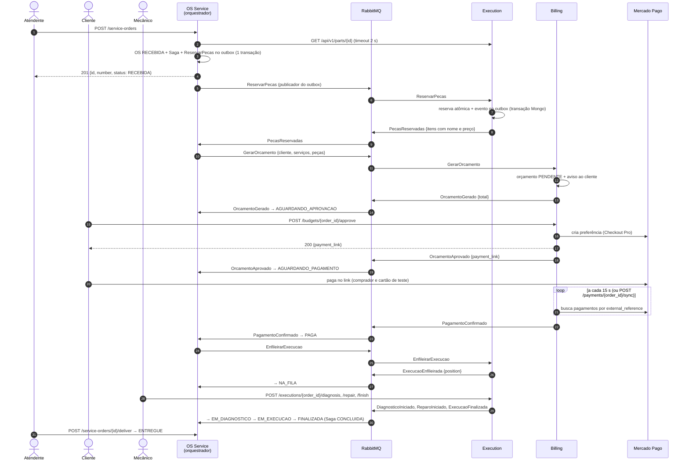
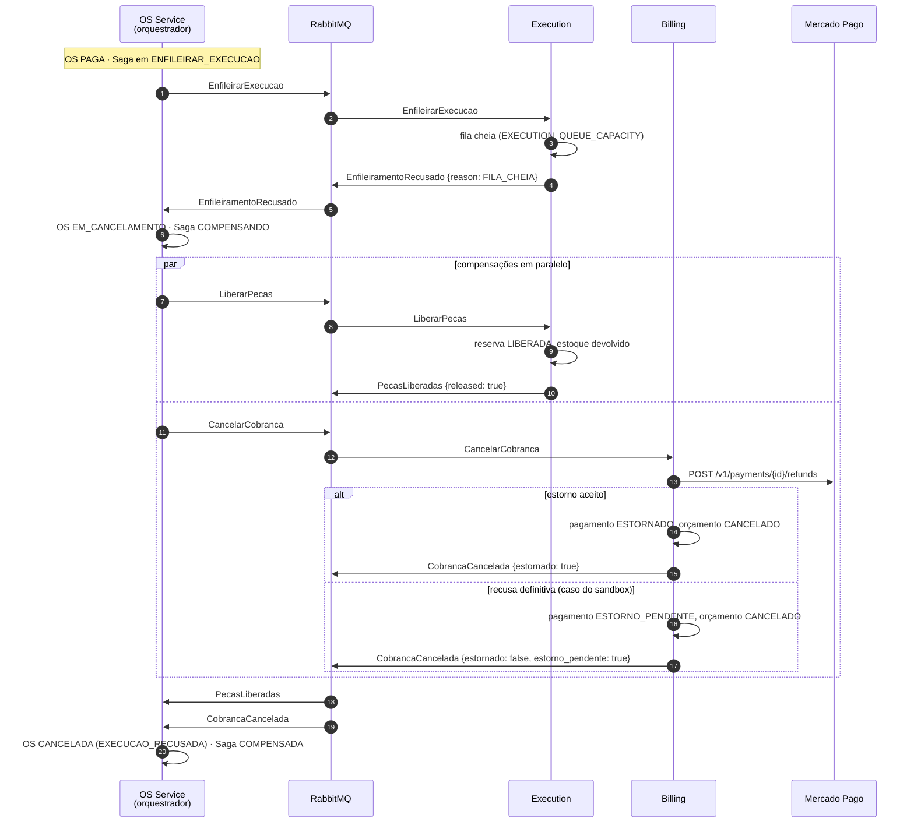

# Saga da ordem de serviço

> Como o fluxo da OS atravessa os três serviços com consistência: etapas, rollback por
> compensação em qualquer etapa e a estratégia adotada. A justificativa da escolha está no
> [ADR-008](../adr/ADR-008-saga-orquestrada.md).

## Estratégia

**Saga orquestrada.** O orquestrador fica **dentro do OS Service**, porque ele é dono do
ciclo de vida da OS. O orquestrador:

- envia **comandos** aos participantes (Execution e Billing) pelo RabbitMQ;
- recebe os **eventos** de resposta e decide o próximo passo;
- persiste o estado da Saga (`saga_instances`, `saga_steps`) **na mesma transação** que
  muda o status da OS, grava a próxima mensagem no outbox e registra o evento como
  processado.

A decisão é pura e fica no domínio ([`app/domain/entities/saga.py`](../../app/domain/entities/saga.py)):
recebe um evento e devolve os comandos a enviar e os status a aplicar na OS. Quem executa a
decisão é o [`SagaOrchestrator`](../../app/application/use_cases/saga_orchestrator.py).

Os participantes não conhecem a Saga: recebem um comando, executam uma transação local e
gravam o resultado no próprio outbox.

## Etapas

| # | Etapa (`saga_steps.step`) | Executor | Comando enviado | Evento de sucesso | Evento(s) de falha | Status da OS no sucesso |
|---|---|---|---|---|---|---|
| 1 | Abrir OS | OS (local) | — (REST do atendente) | — | Erro 4xx; a Saga não começa | `RECEBIDA` |
| 2 | `RESERVAR_PECAS` | Execution | `ReservarPecas` | `PecasReservadas` | `PecasIndisponiveis` | (continua `RECEBIDA`) |
| 3 | `GERAR_ORCAMENTO` | Billing | `GerarOrcamento` | `OrcamentoGerado` | `OrcamentoFalhou` | `AGUARDANDO_APROVACAO` |
| 4 | `AGUARDAR_APROVACAO` *(espera)* | Billing, via REST do cliente | — | `OrcamentoAprovado` (com link de pagamento) | `OrcamentoRecusado`, `OrcamentoExpirado` | `AGUARDANDO_PAGAMENTO` |
| 5 | `AGUARDAR_PAGAMENTO` *(espera)* | Billing, consultando o Mercado Pago | — | `PagamentoConfirmado` | `PagamentoRecusado`, `PagamentoExpirado` | `PAGA` |
| 6 | `ENFILEIRAR_EXECUCAO` | Execution | `EnfileirarExecucao` | `ExecucaoEnfileirada` | `EnfileiramentoRecusado` | `NA_FILA` |
| 7 | `ACOMPANHAR_EXECUCAO` *(espera)* | Execution, via REST do mecânico | — | `DiagnosticoIniciado` → `ReparoIniciado` → `ExecucaoFinalizada` | `ExecucaoCancelada` | `EM_DIAGNOSTICO` → `EM_EXECUCAO` → `FINALIZADA` |

A abertura da OS, a criação da Saga e o comando `ReservarPecas` no outbox são gravados na
mesma transação: não existe OS aberta sem Saga, nem Saga sem OS.

A Saga termina como `CONCLUIDA` em `ExecucaoFinalizada`; nesse momento o Execution já marcou
a reserva como `CONSUMIDA`. A **entrega** (`FINALIZADA → ENTREGUE`) é uma operação REST
simples do OS Service, fora da Saga, porque depois da finalização não há mais nada a
compensar.

## Compensações

Há **duas** ações de compensação, uma por participante. Ambas são **idempotentes** e
**sempre têm sucesso de negócio**: repetir não muda o resultado. O orquestrador só desfaz o
que foi feito: `LiberarPecas` se a etapa de reserva foi concluída, `CancelarCobranca` se a
etapa de orçamento foi concluída. O `payload` de ambas leva o motivo (`reason`).

| Comando de compensação | Executor | O que faz | Evento de confirmação |
|---|---|---|---|
| `LiberarPecas` | Execution | Reserva `RESERVADA` → `LIBERADA` e devolve o estoque. Se não houver reserva, ou se ela já estiver liberada ou consumida, não faz nada | `PecasLiberadas {released}` |
| `CancelarCobranca` | Billing | Orçamento `PENDENTE` ou `APROVADO` → `CANCELADO`. Pagamento `PENDENTE` → `CANCELADO` (e expira o link no Mercado Pago). Pagamento `APROVADO` → **estorno** no Mercado Pago → `ESTORNADO`, ou `ESTORNO_PENDENTE` se o provedor recusar o estorno de forma definitiva | `CobrancaCancelada {estornado, refund_id, estorno_pendente}` |

### Matriz: qual falha dispara qual compensação

| Falha | `LiberarPecas` | `CancelarCobranca` | Estorno? | `cancel_reason` |
|---|:---:|:---:|:---:|---|
| `PecasIndisponiveis` | — ¹ | — | — | `PECAS_INDISPONIVEIS` |
| `OrcamentoFalhou` | ✅ | — | — | `ORCAMENTO_FALHOU` |
| `OrcamentoRecusado` | ✅ | ✅ ² | — | `ORCAMENTO_RECUSADO` |
| `OrcamentoExpirado` | ✅ | ✅ ² | — | `APROVACAO_EXPIRADA` |
| `PagamentoRecusado` | ✅ | ✅ | — | `PAGAMENTO_RECUSADO` |
| `PagamentoExpirado` | ✅ | ✅ | — | `PAGAMENTO_EXPIRADO` |
| `EnfileiramentoRecusado` | ✅ | ✅ | **✅** | `EXECUCAO_RECUSADA` |
| `ExecucaoCancelada` | ✅ | ✅ | **✅** | `EXECUCAO_CANCELADA` |

¹ A reserva é **tudo ou nada** (transação no MongoDB): se uma peça falta, nenhuma é
reservada, e não há o que liberar. A OS vai direto para `CANCELADA`.
² O orçamento já está `RECUSADO` ou `EXPIRADO`; o comando é enviado mesmo assim, porque a
etapa de orçamento foi concluída, e o Billing não muda nada.

**Ordem:** as compensações são enviadas **em paralelo**. A OS só vai para `CANCELADA` quando
**todas** as confirmações chegam. Até lá, fica em `EM_CANCELAMENTO`.

**Estorno recusado pelo provedor.** O sandbox do Mercado Pago recusa estorno por API. Uma
recusa definitiva (resposta 4xx que não seja 429) não trava a Saga: o pagamento fica
`ESTORNO_PENDENTE`, a compensação é confirmada com `estorno_pendente: true` e o log registra
`ESTORNO MANUAL NECESSÁRIO`. O estorno é feito no painel do Mercado Pago, e o monitor de
pagamentos concilia o status para `ESTORNADO` quando a consulta passa a mostrá-lo. Falhas
temporárias (rede, 5xx, 429) seguem o caminho normal de nova tentativa e DLQ.

## Idempotência e mensagens fora de ordem

| Situação | Tratamento |
|---|---|
| Mesma mensagem entregue duas vezes (o RabbitMQ garante *at-least-once*) | Todo consumidor grava o `message_id` em `processed_messages` na mesma transação do efeito. Se já existe, descarta |
| Mesmo comando reenviado com outro `message_id` (reenvio de etapa parada) | Idempotência **de negócio** por `order_id`: reserva, orçamento e execução são únicos por OS. Reprocessar não refaz o efeito e grava de novo o mesmo evento de resposta |
| Evento de etapa já concluída (atrasado ou repetido) | O orquestrador registra e ignora, **exceto** um `PagamentoConfirmado` com a Saga em `COMPENSANDO` ou `COMPENSADA`: aí envia `CancelarCobranca` de novo, que estorna o pagamento tardio |
| Evento adiantado: de etapa futura com a Saga em andamento (consumo paralelo, `OrcamentoAprovado` antes de `OrcamentoGerado`) | Não é registrado como processado: a exceção leva o evento à fila de retry, e ele volta quando o anterior já foi aplicado |
| Andamento da execução fora de ordem (`DiagnosticoIniciado`, `ReparoIniciado` e `ExecucaoFinalizada` são da mesma etapa) | Decidido pelo status da OS: evento de status já alcançado é ignorado; evento que pula um status (`ExecucaoFinalizada` com a OS `EM_DIAGNOSTICO`) volta pela fila de retry |
| Pagamento feito depois do prazo | Ao expirar, o Billing também expira o link no Mercado Pago. Se mesmo assim o cliente pagar, o Billing continua consultando pagamentos expirados ou cancelados por 24 h (`LATE_PAYMENT_WINDOW_HOURS`), publica `PagamentoConfirmado` e cai no caso acima |
| Evento de uma Saga desconhecida (OS sem Saga ou `saga_id` diferente) | Registrado como processado e ignorado |

## Isolamento: a falta do "I" do ACID

Sem isolamento entre transações locais, outra operação poderia ver uma OS no meio da Saga.
Contramedidas adotadas:

| Contramedida | Onde |
|---|---|
| **Bloqueio semântico** | O status da OS (`RECEBIDA`…`PAGA`, `EM_CANCELAMENTO`) indica que há uma Saga em curso. A entrega só é aceita em `FINALIZADA`; aprovar e recusar só valem para orçamento `PENDENTE` e dentro do prazo |
| **Atualização comutativa** | A reserva muda o estoque por `$inc` atômico e condicional (`stock_quantity - reserved_quantity >= quantidade`). Duas reservas concorrentes nunca separam a mesma peça; quem perde a corrida refaz a transação inteira |
| **Visão pessimista** | A ordem das etapas foi escolhida para isso: **reservar antes de cobrar**. A etapa difícil de desfazer (cobrança) vem depois das fáceis |
| **Releitura do valor** | Aprovar o orçamento relê a linha com `SELECT … FOR UPDATE` e exige `PENDENTE`; uma aprovação duplicada ou atrasada é rejeitada (`422`) |
| **Trava na linha da Saga** | O orquestrador lê a Saga com `SELECT … FOR UPDATE`: dois eventos da mesma Saga processados ao mesmo tempo em réplicas diferentes não se sobrepõem |

## Falhas de infraestrutura

| Falha | Comportamento |
|---|---|
| Um participante fora do ar | Os comandos ficam na fila do RabbitMQ; a Saga espera. Quando o participante volta, consome e continua |
| Um serviço cai depois de mudar o estado e antes de publicar | O **outbox** garante a entrega: a mensagem foi gravada na mesma transação e é publicada quando o serviço volta. Vale para os três serviços |
| O RabbitMQ reinicia (no cluster ele roda sem volume persistente) e perde mensagens que estavam na fila | Comandos perdidos são cobertos pelo **reenvio de etapa parada**: uma etapa com comando sem resposta há `SAGA_STEP_RETRY_SECONDS` (120 s) recebe o comando de novo, e o participante, idempotente, só regrava o evento. Eventos das etapas de espera (aprovação, pagamento e andamento da execução) não têm comando para reenviar: se se perderem no broker, a OS fica parada naquela etapa |
| Mensagem que sempre falha ao processar (bug, payload inválido) | 3 novas tentativas com 5 s de intervalo → **DLQ** → alerta no New Relic. Envelope inválido vai direto para a DLQ. Se for um comando de compensação, o reenvio de etapa parada continua mandando o comando a cada 120 s até a confirmação chegar |
| Mercado Pago fora do ar | Aprovar devolve `502` e nada é gravado: o orçamento continua `PENDENTE` e o cliente tenta de novo. A consulta de pagamentos tenta de novo no ciclo seguinte (15 s). O estorno é um comando: falha temporária vai para nova tentativa e, se esgotar, para a DLQ |

## Sequência — caminho feliz

## Sequência — falha tardia com estorno (`EnfileiramentoRecusado`)

É o cenário mais completo: a falha acontece **depois do pagamento**, e as duas compensações
rodam, incluindo o pedido de estorno no Mercado Pago.

## Cenários BDD

Escritos em Gherkin, em português, em
[`tests/bdd/features/saga_ordem_de_servico.feature`](../../tests/bdd/features/saga_ordem_de_servico.feature).
Os passos usam a API real do OS Service e o orquestrador de verdade; só as respostas do
Execution e do Billing são simuladas, com os mesmos eventos que eles publicariam.

1. **Caminho feliz**, da abertura à entrega do veículo.
2. **Peça indisponível** → OS `CANCELADA` sem nada a desfazer.
3. **Orçamento recusado** → peças liberadas e cobrança cancelada.
4. **Pagamento recusado** → reserva e cobrança desfeitas.
5. **Oficina lotada depois do pagamento** → cobrança cancelada com estorno do valor pago.
