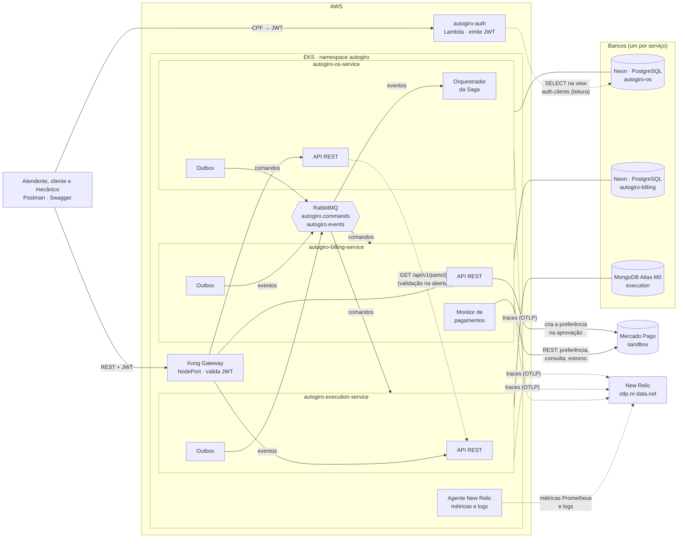

# Visão geral da arquitetura

> Diagrama geral da plataforma (microsserviços, bancos e comunicação) e mapa para os demais
> documentos desta pasta.

## Diagrama geral

**Legenda das setas:** linha cheia = chamada ou mensagem do fluxo principal · tracejada =
leitura auxiliar ou telemetria.

## Os três microsserviços

| Serviço | Contexto de negócio | É dono de | Banco | Papel na Saga |
|---|---|---|---|---|
| **OS Service** | Atendimento | Clientes, veículos, catálogo de serviços, ordens de serviço, histórico de status, estado da Saga | PostgreSQL (Neon) | **Orquestrador** |
| **Billing Service** | Cobrança | Orçamentos, pagamentos, estornos | PostgreSQL (Neon) | Participante |
| **Execution Service** | Produção | Peças e estoque, reservas, fila de execução, diagnóstico e reparo | MongoDB (Atlas M0) | Participante |

Componentes de plataforma, que não são microsserviços de negócio:

| Componente | Repositório | Função |
|---|---|---|
| Lambda de autenticação | [autogiro-auth](https://github.com/Figueiraa/autogiro-auth) | Emite o JWT por CPF. Pertence ao contexto de Atendimento ([ADR-013](../adr/ADR-013-lambda-no-contexto-de-atendimento.md)) |
| Cluster EKS, Kong, RabbitMQ, agente New Relic, painéis e alertas | [autogiro-infra-k8s](https://github.com/Figueiraa/autogiro-infra-k8s) | Plataforma compartilhada, em Terraform |

O RabbitMQ roda dentro do cluster (uma réplica, sem volume persistente). Os bancos ficam
fora dele, no Neon e no Atlas, para sobreviver à recriação do cluster.

## Estratégias de comunicação

| Tipo | Onde é usado | Por quê |
|---|---|---|
| **REST síncrono** | Entre cliente e serviços, sempre pelo Kong | O usuário espera resposta imediata |
| **REST síncrono entre serviços** | **Um único ponto:** o OS Service consulta `GET /api/v1/parts/{id}` no Execution ao abrir a OS, pelo DNS interno do cluster e repassando o token de quem abriu | Avisar o atendente na hora que uma peça não existe (`422`). Se o Execution não responder em 2 s (`EXECUTION_SERVICE_TIMEOUT_SECONDS`), a OS abre mesmo assim e a Saga valida a peça na reserva |
| **REST síncrono externo** | Billing → Mercado Pago | API do provedor: criar a preferência, consultar pagamentos, estornar e expirar o link |
| **Mensageria assíncrona** | Todo o fluxo da Saga: comandos do orquestrador e eventos dos participantes | Desacopla no tempo: um participante fora do ar atrasa a Saga, mas não a quebra |

Os três serviços gravam as mensagens que produzem num **outbox**, na mesma transação da
mudança de estado, e um publicador em segundo plano as entrega ao RabbitMQ
([ADR-009](../adr/ADR-009-confiabilidade-das-mensagens.md)).

## Documentos desta pasta

| Arquivo | Conteúdo |
|---|---|
| [posse-dos-dados.md](posse-dos-dados.md) | Quem é dono de cada dado, o modelo de cada banco e o que é cópia |
| [maquina-de-estados.md](maquina-de-estados.md) | Estados da OS, da Saga, do orçamento, do pagamento, da reserva e da execução |
| [saga.md](saga.md) | Etapas, compensações, idempotência, isolamento, falhas e diagramas de sequência |
| [mensageria.md](mensageria.md) | Envelope, topologia no RabbitMQ, catálogo de mensagens, retry e DLQ |
| [APIs e gateway](https://github.com/Figueiraa/autogiro-infra-k8s/blob/main/docs/apis-e-gateway.md) | Endpoints de cada serviço e rotas no Kong (no `autogiro-infra-k8s`) |
| [../adr/](../adr/) | Decisões de arquitetura (ADR-005 a ADR-013) |
